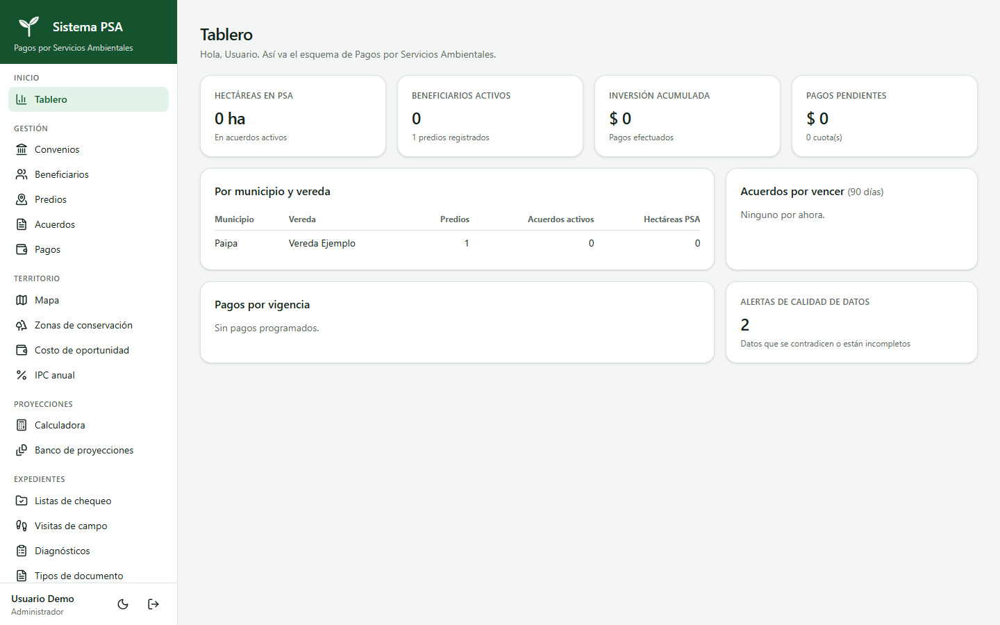
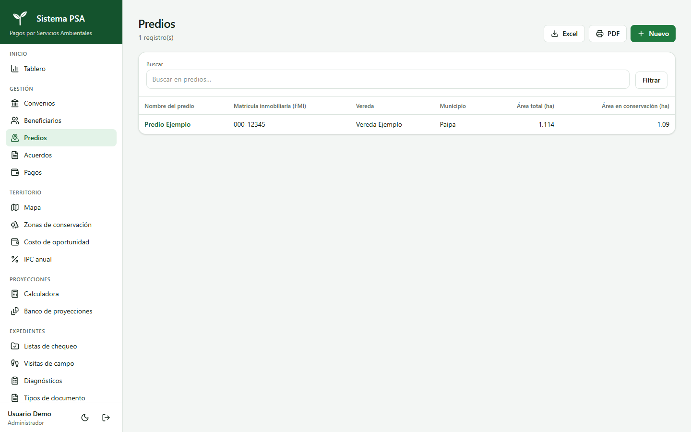
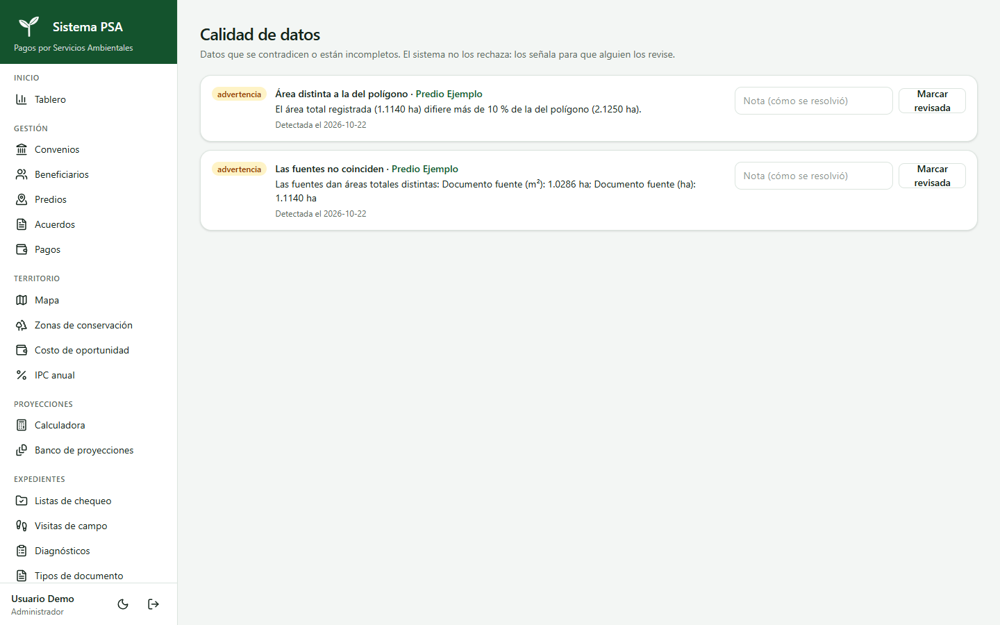
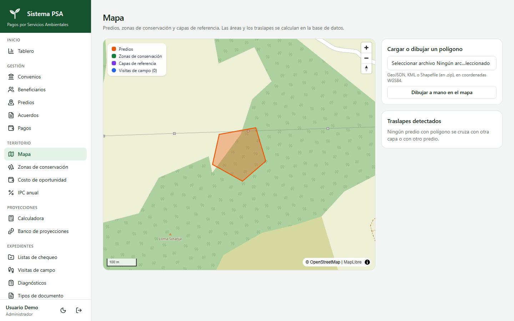
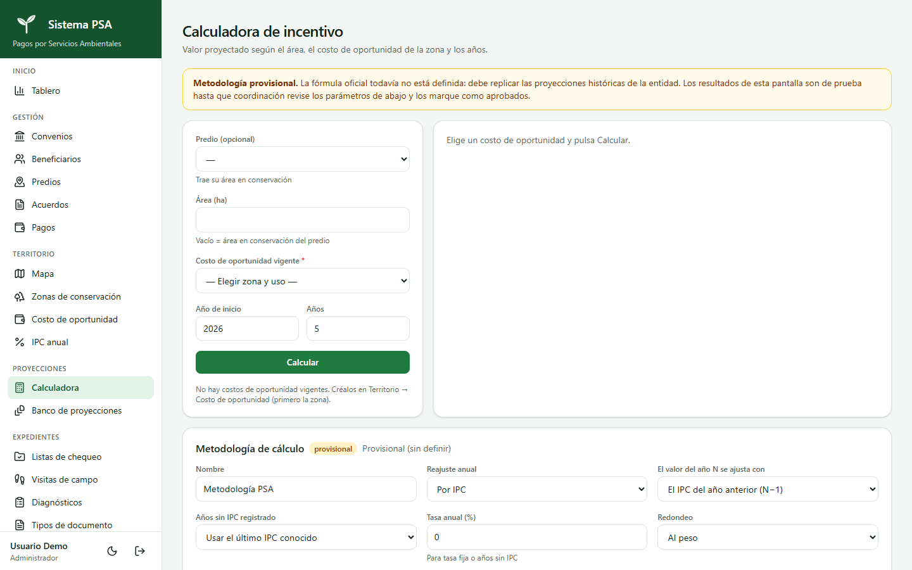
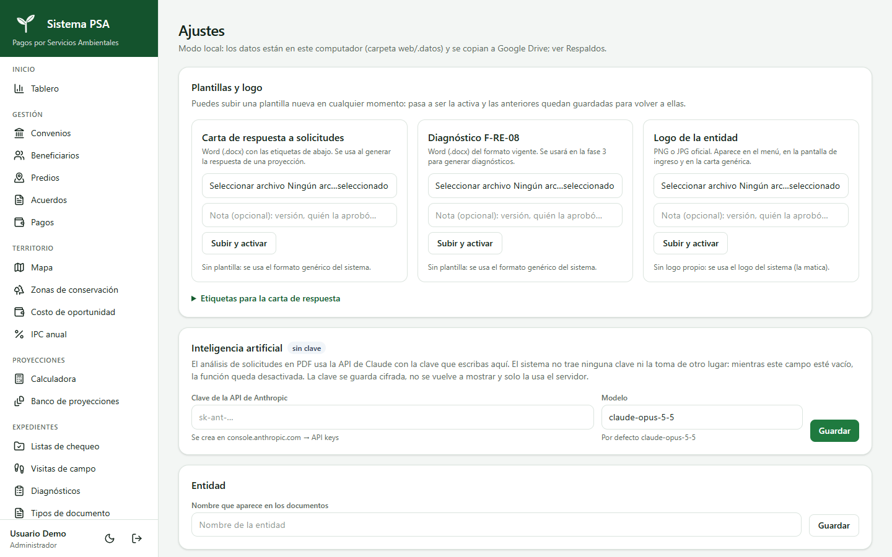

# Proyecto PSA — Plataforma de gestión de Pagos por Servicios Ambientales

Plataforma web para gestionar programas de **Pagos por Servicios Ambientales (PSA)**: convenios, beneficiarios, predios, acuerdos, pagos, expedientes documentales, mapas de las zonas de conservación y visitas de campo. Su aplicación móvil de campo es **[PSA Campo](https://github.com/ricardoprs76-max/psa-campo)**.

## Problema que resuelve
Los programas PSA de las autoridades ambientales manejan cientos de documentos, predios y pagos repartidos en hojas de cálculo, carpetas y correos. Así es difícil saber qué expediente está completo, qué certificado venció o cuánto incentivo corresponde a un predio. La plataforma centraliza esa información, valida la calidad de los datos según las reglas del programa y conecta la oficina con el trabajo de campo.

Nace de la experiencia jurídica y técnica del autor en proyectos PSA y en contratación pública en el sector ambiental.

## Tecnologías
- **Next.js 16** (16.4.2), **React 19**, **TypeScript** y **Tailwind CSS 4**
- **PostgreSQL + PostGIS**: PGlite embebida (modo local) o PostgreSQL en la nube (Neon / Supabase)
- **MapLibre GL** (mapa satelital, polígonos, GeoJSON / Shapefile / KML)
- **Claude API** (SDK oficial de Anthropic) con salida estructurada validada con **Zod**, para leer solicitudes en PDF
- **Google Apps Script + Google Drive** para archivos y respaldos diarios
- Despliegue en **Render** (`render.yaml`) o Docker (`Dockerfile`)

## Funcionalidades principales
- **Registro y control:** convenios, beneficiarios, predios, acuerdos y pagos, con búsqueda, filtros y exportación a Excel/PDF.
- **Tablero:** hectáreas, beneficiarios, inversión, pagos pendientes y acuerdos por vencer.
- **Alertas de calidad de datos:** reglas que detectan áreas contradictorias, formatos inválidos y documentos vencidos.
- **Usuarios y roles:** administrador, coordinador, financiero, consulta y funcionario de campo; contraseña común guardada como huella scrypt y cierre de sesiones al cambiarla.
- **Territorio:** mapa satelital interactivo, dibujo y carga de polígonos, traslapes y cálculo de áreas.
- **Calculadora de incentivo** con costo de oportunidad, IPC y banco de proyecciones.
- **Solicitudes con IA:** extracción de datos de un PDF con revisión humana obligatoria y borrador de respuesta en Word.
- **Expedientes:** documentos con versiones y vencimientos, listas de chequeo con porcentaje de completitud y diagnósticos F-RE-08 en Word, con verificación de nombres científicos en GBIF.
- **Importación** desde Excel/CSV y exportaciones de ODK.
- **Visitas de campo** recibidas desde [PSA Campo](https://github.com/ricardoprs76-max/psa-campo) (GPS, fotos y firma) y mostradas en el mapa.
- **Respaldos** diarios en Google Drive y restauración.

## Capturas de pantalla
Capturas tomadas con los datos ficticios de `supabase/seed.sql`.

| Tablero | Predios |
|---|---|
|  |  |

| Alertas de calidad de datos | Mapa con el polígono del predio |
|---|---|
|  |  |

| Calculadora de incentivo | Ajustes |
|---|---|
|  |  |

## Instalación y uso
**Requisitos:** Node.js 22.

### Modo local (sin servicios externos)
```bash
git clone https://github.com/ricardoprs76-max/psa.git
cd psa/web
npm install
npm run dev          # http://localhost:3210
```
La primera vez se crea la cuenta del administrador y se fija la **contraseña común** con la que entra todo el equipo (cada persona con su propio correo). Se guarda solo como huella cifrada en la base de datos y se cambia en **Ajustes**; al cambiarla se cierran todas las sesiones. Los datos se guardan en `web/.datos/` (excluida del repositorio). Hay datos ficticios de ejemplo en `supabase/seed.sql`.

### En la nube (Render + PostgreSQL + Google Drive)
1. Crea una base PostgreSQL con PostGIS (por ejemplo, en Neon) y copia la **conexión directa**.
2. Instala `nube/Codigo.gs` como aplicación web de Apps Script en la cuenta dueña de la carpeta de Drive y cambia su `TOKEN` por uno largo y secreto.
3. En Render, crea un *Blueprint* desde este repositorio y define las variables `DATABASE_URL`, `PSA_NUBE_URL`, `PSA_NUBE_TOKEN` y `PSA_SECRETO`.
4. La clave de la API de Claude (opcional) se ingresa en **Ajustes → Inteligencia artificial** y se guarda cifrada.

## Proyectos relacionados
- **[PSA Campo](https://github.com/ricardoprs76-max/psa-campo):** app Android (Flutter) para las visitas de campo, sincronizada con esta plataforma.

## Contacto
**Ricardo Augusto Porras Díaz** — Desarrollador de software y abogado especialista en derecho administrativo
- Correo: [ricardoprs76@gmail.com](mailto:ricardoprs76@gmail.com)
- GitHub: [github.com/ricardoprs76-max](https://github.com/ricardoprs76-max)
